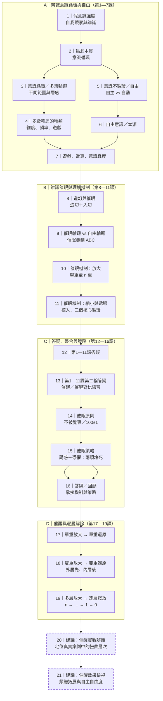

# 《催醒俱樂部》第1—19課關係圖

> 本圖是對已完成第1—19課的回顧性結構整理。連線表示課程主題之間的承接關係，不表示所有課程原先就是按此圖預先設計。  
> 第20、21課為後續建議，使用虛線標示，並非已完成課程。

## 一、19課主線圖

## 二、各階段之間的關係

| 階段 | 課次 | 核心問題 | 導向下一階段 |
|---|---:|---|---|
| 辨識循環與自由 | 1—7 | 意識如何循環？自由與當真如何辨識？ | 為辨識催眠及入幻建立概念基礎 |
| 理解催眠機制 | 8—11 | 如何造幻、入幻、放大、縮小、植入並形成遞歸？ | 為辨識催眠原則與策略建立機制基礎 |
| 整合與策略 | 12—16 | 前段內容有哪些疑問？催眠如何降低覺察、以誘惑與恐懼維持循環？ | 為實際催醒方法建立問題定位 |
| 逐層催醒 | 17—19 | 如何從單層、雙層到多層解除扭曲？ | 為真實案例練習與效果檢視提供方法基礎 |

## 三、第20、21課建議放置位置

### 第20課建議｜催醒實戰：辨識並定位多層催眠結構

**位置：第19課之後，作為實戰應用的第一步。**

建議要點：
1. 從實際生活經驗或學員提出的案例開始，不先套用結論。
2. 辨識案例中哪些是基本意識，哪些是放大、縮小或後續植入。
3. 區分單層、雙層與多層結構，並辨識是否出現「載體—身份—我」及「相信—當真—強化認同」等循環表現。
4. 把誘惑、恐懼、100±1方向性引導等內容，作為案例檢視線索，而不是預設每個案例都必然符合。
5. 完成案例結構圖，標出可能的層次與待核實之處，再決定是否進入逐層還原。

**與前課的連接：**第17—19課教的是如何逐層解除；第20課先練習在真實經驗中辨識「要處理的是哪一層、哪一種扭曲」。

### 第21課建議｜催醒效果：意識頻譜拓展與自主自由度檢視

**位置：第20課之後，作為實戰後的觀察與檢視。**

建議要點：
1. 回看第20課案例處理前後，意識焦點與可觀察範圍是否有所變化。
2. 檢視是否減少自動化反應，增加自主觀察與自主決策。
3. 對照「意識頻譜拓展」與「意識自由度」兩個不同觀察方向，不把兩者混成單一指標。
4. 檢視是否仍有未解除的層次或新的當真循環；如有，回到相應層次繼續辨識。
5. 不預設每個人都會得到相同結果，也不把某個固定狀態設定成所有人的標準答案。

**與前課的連接：**第20課回答「如何辨識並定位」；第21課回答「處理後觀察什麼變化、如何檢視自主性與頻譜」。這也承接原始課程大綱中「催醒的效果（意識頻譜拓展點）」與「催醒的效果（意識自由度檢測點）」兩項主題。

## 四、圖例與閱讀方式

- **實線框／實線箭頭：**已完成的第1—19課及其回顧性承接關係。
- **虛線框／虛線箭頭：**建議中的第20、21課，尚未講授。
- 第12、13、16課保留在主線中：答疑與回顧是已完成課程的一部分。
- 本圖只整理課程內容之間的關係，不把課程中的經驗模型自動表述為已獲普遍科學驗證的事實。
