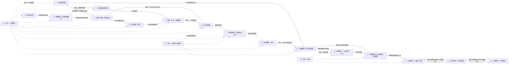

# 《催醒俱樂部》第1—19課：非線性知識關係圖

> 本圖是供課程回顧與知識分析使用的開放式關係網絡，不是學生的學習路線圖。
> 第1—19課的編號只保留實際授課記錄；不代表知識層級、學習順序、預設主線或未來課程安排。
> 連線表示目前可由課程內容支持的主題關聯；不表示必須先學某一課、再學另一課。

## 一、已完成課程節點

## 二、如何閱讀這張圖

- **節點是課程，不是步驟。** 每個節點可以獨立被回顧，也可以與多個其他節點產生交叉關係。
- **連線不是教學指令。** 線條只標記目前可辨識的主題關聯，不要求學生依線條順序學習。
- **課次編號不是知識階梯。** 第17課不因編號較大就代表比第10課更高級；課次只用來追溯原始授課記錄。
- **答疑課是獨立節點。** 第12、13、16課不合併、不刪除；虛線表示回看或答疑關係，而非課程的前後順序。
- **局部有序不等於整體線性。** 第17—19課所涉及的單層、雙層、多層處理，存在方法複雜度上的關聯；這不構成整套課程的固定學習路徑。
- **網絡保持開放。** 新的交叉關係可以隨探索而出現；現有連線也可以在取得更多原始課程資料後修訂。

## 三、目前可見的知識空白／待探索點

以下是分析時發現的候選知識節點，不是已決定開設的課程，也不預設數量、次序或形式。

| 候選知識點 | 為何值得再檢視 | 目前狀態 |
|---|---|---|
| 意識植入方式與識別 | 第9—11課涉及外部影響、植入及遞歸；現有課程摘要尚未把各種植入方式與識別線索獨立整理 | 待核對原始內容，確認是否已有充分講授 |
| 催醒機制的雙向處理 | 已完成課程明確討論放大與縮小，但第17—19課摘要主要記錄放大結構的逐層解除 | 需確認縮小方向的催醒處理是否已講授 |
| 混合型多層結構 | 現有摘要分別說明放大、縮小及多層遞歸；不同方向混合時如何辨識與處理，尚未清楚呈現 | 開放問題 |
| 催醒效果的觀察與檢視 | 原始課程大綱提及意識頻譜拓展及意識自由度檢測；現有第1—19課摘要未能確認是否已完整覆蓋 | 待核對原始課堂記錄 |
| 輪迴系統的整體架構 | 已涉及不同範圍、維度、種類及遊戲模型；各類載體、系統層級與相互關係是否完整呈現，仍可再檢視 | 開放問題 |
| 自由意識與不可預測性 | 已有意識自由、自主意識、遊戲與當真等節點；不可預測性如何在實際經驗中辨識，仍可探索 | 開放問題 |

這些空白可能在其他課堂、答疑或補充材料中已經涉及；在核對原始材料前，不應直接判定為「未教」。

## 四、知識網絡的工作原則

1. 先忠實記錄已發生的課程內容，再辨識關係；不為了圖形整齊而創造主線。
2. 不因兩課相鄰就自動連線，也不因兩課相距較遠就忽略可能存在的關聯。
3. 不預設課程數量、未來課次、主題順序或學習終點。
4. 不把地圖提供給學生作為唯一或固定的學習路徑；教學重點是探索不可預測，而不是訓練學生預測下一個答案。
5. 允許學生提出新的問題、跨越既有分類、建立未曾預設的連結。
6. 每一個候選空白都需要回到課程原文、實戰經驗或新的探索中核實；不能只憑地圖推測。

## 五、資料限制

- 第1—15課：以已上傳的《催醒俱樂部-課程》DOCX 為主要依據。
- 第16—19課：依此前已確認的課程記錄整理；目前 DOCX 未包含完整逐課原始文字。
- 本圖是可修訂的分析工具，不是課程定義、教學承諾或對學生的學習要求。
