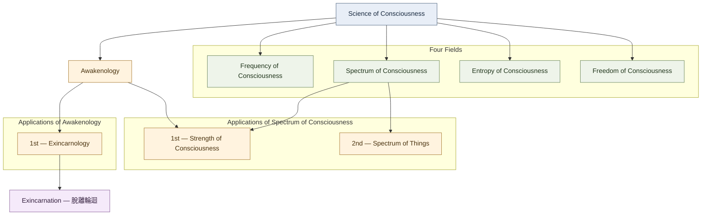

# Science of Consciousness

## Framework overview

**Science of Consciousness** is the foundational science in this framework. It is organized into four fields of study and has applications, including Awakenology.

This document records the framework as currently defined by its author. The names and relationships below are framework terminology, not a claim that this is an established mainstream scientific taxonomy.

## 1. Four fields of Science of Consciousness

1. **Frequency of Consciousness**
2. **Spectrum of Consciousness**
3. **Entropy of Consciousness**
4. **Freedom of Consciousness**

## 2. Applications and their relationships

The diagram shows two related application branches. **Strength of Consciousness belongs to both Awakenology and Spectrum of Consciousness**; this dual relationship is intentional.

## 3. Application definitions

| Application | Position in the framework | Description |
| --- | --- | --- |
| **Awakenology** | Application of Science of Consciousness | The umbrella framework, encompassing both 催醒法 (methods/practice) and 催醒學 (knowledge/principles). |
| **Exincarnology** | 1st application of Awakenology | The specialized discipline and practical framework concerning 脫離輪迴. It encompasses 脫離輪迴學 and 脫離輪迴法. |
| **Strength of Consciousness** | 2nd application of Awakenology; 1st application of Spectrum of Consciousness | An application with two parent relationships in this framework. Its existing glossary term is 意識強度. |
| **Spectrum of Things** | 2nd application of Spectrum of Consciousness | The wireless-sensor project discussed in the framework: using sensors to investigate and measure physical phenomena beyond ordinary human perception. |

## 4. Exincarnation terminology

- **Exincarnology** — 脫離輪迴法（脫離輪迴學）
- **Exincarnation** — 脫離輪迴

Exincarnology names the discipline and practical framework; Exincarnation names the process or achievement it aims at. The term Exincarna is superseded in this terminology structure.

## 5. Naming notes

- The Chinese terminology explicitly established so far is retained as written above.
- No Chinese name is assigned here to **Science of Consciousness** or **Spectrum of Things**; do not invent or standardize one without the author's direction.
- **Strength of Consciousness** is the selected English name. Do not revert to “Consciousness Strength.”
- Keep **Strength of Consciousness** connected to both parent branches in diagrams, indexes, and explanatory text.
- The four fields are presented as the author's proposed structure within this framework.

## 6. Current structure at a glance

- **Foundational science:** Science of Consciousness
- **Fields:** Frequency, Spectrum, Entropy, and Freedom of Consciousness
- **Application of the foundational science:** Awakenology
- **Applications of Awakenology:** Exincarnology (1st) and Strength of Consciousness (2nd)
- **Applications of Spectrum of Consciousness:** Strength of Consciousness (1st) and Spectrum of Things (2nd)
- **Exincarnation:** 脫離輪迴, the process or achievement associated with Exincarnology
