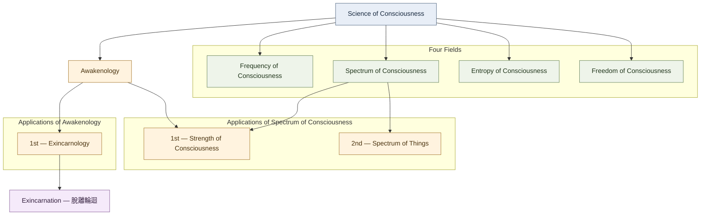

# Science of Consciousness

## Framework overview

**Science of Consciousness** is the foundational science in this framework. It is organized into four fields of study and has applications, including Awakenology.

This document records the framework as currently defined by its author. The names and relationships below are framework terminology, not a claim that this is an established mainstream scientific taxonomy.

## Scientific scope and methodology

Science of Consciousness is intended to develop practical, testable, experimentally verifiable knowledge. Its purpose is not to construct systems of belief, religion, philosophy, or abstract speculation detached from observable evidence and real-world application.

Work should progress from an **idea** to a clearly defined **concept**, then to a **proof of concept (PoC)** conducted through a defined measurement method. The measurement method must specify the observable indicators, variables, instruments or procedures, calibration, and conditions of measurement. A PoC provides an initial demonstration that the concept can be operationalized and investigated; it is not, by itself, proof that the concept's underlying explanation is true. The work then proceeds through experiments, reproducibility or independent verification, and evaluation of practical application. Findings remain open to challenge and revision.

Explanatory validity and practical effectiveness must be evaluated separately. A method may be practically useful even when its underlying explanation is incomplete or later proves incorrect; that usefulness does not validate the explanation. Likewise, a correct explanation does not by itself demonstrate that a method based on it works in practice. Report both what is understood about the phenomenon and what has been demonstrated to work, without treating either as proof of the other.

The working methodology is guided by five principles:

1. **Quantifiable:** Define what is being measured.
2. **Measurable:** Identify observable signals and measurable variables.
3. **Experimental:** Design experiments that can test the proposed relationships.
4. **Reproducible:** Allow independent experiments to verify or challenge results.
5. **Practical:** Produce knowledge that can be applied in the real world.

Measurements should distinguish directly observed signals from estimates or interpretations derived from them. Where sensors and assessment systems are used, the operational definitions, calibration, uncertainty, and limits of inference should be made explicit. The goal is to develop methods that can be examined through real-world experiments rather than asking readers to accept claims on belief or authority.

## Team operating standard

Every team member, contributor, researcher, and AI assistant working on this project must follow the scientific scope and five principles above. These are working standards for the whole team, not optional writing preferences.

The team must keep the following stages distinct:

- **Idea:** An initial observation, question, possibility, or proposed direction for investigation.
- **Concept:** A clearly described idea with defined meaning and scope. Naming a concept does not, by itself, demonstrate that the described phenomenon exists.
- **Proof of concept (PoC):** An initial practical test of whether the concept can be operationalized, measured, or used. A PoC must be conducted through a defined measurement method.
- **Measurement method:** The procedure used within the PoC and subsequent experiments, specifying what is observed, which instruments or sensors are used, how data are collected and calibrated, and how uncertainty is handled.
- **Experimental result:** An outcome obtained under stated experimental conditions. Report what was observed, including limitations and unexpected or contrary results.
- **Reproduced or independently verified result:** A result that has been tested again, ideally by independent people or teams, using sufficiently documented methods.
- **Practical application:** A method or finding whose real-world usefulness has been evaluated. Practical effectiveness must be assessed separately from the validity of the explanation behind the method. Do not claim effectiveness beyond what the evidence supports.

### Required practice for team work

Before presenting a claim as scientific knowledge, contributors should be able to answer:

1. What exactly is being measured or tested?
2. What observable signal or variable represents it?
3. How is the measurement obtained, calibrated, and interpreted?
4. What experiment could support or challenge the claim?
5. Can another person or team reproduce the procedure and assess the result?
6. What are the uncertainty, limitations, and alternative explanations?
7. What practical use is demonstrated, if any?
8. Is the practical result being evaluated separately from the validity of the proposed explanation?

If these questions cannot yet be answered, label the work accurately as an idea, concept, or preliminary PoC, and identify the next stage of work needed. Do not fill gaps with confident wording, invented precision, appeals to authority, or belief.

The team should neither accept nor reject a claim solely because it agrees or disagrees with existing beliefs, theories, philosophies, or expectations. Evaluate it through transparent methods and evidence. Unexpected observations should be documented and investigated carefully; they should not be turned into conclusions before they have been tested.

**The standard is not whether an explanation sounds convincing. The standard is whether the claim is clearly defined, measurable, experimentally testable, reproducible, and practically useful to the extent claimed.**

## 1. Four fields of Science of Consciousness

1. **Frequency of Consciousness**
2. **Spectrum of Consciousness**
3. **Entropy of Consciousness**
4. **Freedom of Consciousness**

## 2. Applications and their relationships

The diagram shows two related application branches. **Strength of Consciousness belongs to both Awakenology and Spectrum of Consciousness**; this dual relationship is intentional.

## 3. Application definitions

| Application | Position in the framework | Description |
| --- | --- | --- |
| **Awakenology** | Application of Science of Consciousness | The umbrella framework, encompassing both 催醒法 (methods/practice) and 催醒學 (knowledge/principles). |
| **Exincarnology** | 1st application of Awakenology | The specialized discipline and practical framework concerning 脫離輪迴. It encompasses 脫離輪迴學 and 脫離輪迴法. |
| **Strength of Consciousness** | 2nd application of Awakenology; 1st application of Spectrum of Consciousness | An application with two parent relationships in this framework. Its existing glossary term is 意識強度. |
| **Spectrum of Things** | 2nd application of Spectrum of Consciousness | The wireless-sensor project discussed in the framework: using sensors to investigate and measure physical phenomena beyond ordinary human perception. |

## 4. Exincarnation terminology

- **Exincarnology** — 脫離輪迴法（脫離輪迴學）
- **Exincarnation** — 脫離輪迴

Exincarnology names the discipline and practical framework; Exincarnation names the process or achievement it aims at. The term Exincarna is superseded in this terminology structure.

## 5. Naming notes

- The Chinese terminology explicitly established so far is retained as written above.
- No Chinese name is assigned here to **Science of Consciousness** or **Spectrum of Things**; do not invent or standardize one without the author's direction.
- **Strength of Consciousness** is the selected English name. Do not revert to “Consciousness Strength.”
- Keep **Strength of Consciousness** connected to both parent branches in diagrams, indexes, and explanatory text.
- The four fields are presented as the author's proposed structure within this framework.

## 6. Current structure at a glance

- **Foundational science:** Science of Consciousness
- **Fields:** Frequency, Spectrum, Entropy, and Freedom of Consciousness
- **Application of the foundational science:** Awakenology
- **Applications of Awakenology:** Exincarnology (1st) and Strength of Consciousness (2nd)
- **Applications of Spectrum of Consciousness:** Strength of Consciousness (1st) and Spectrum of Things (2nd)
- **Exincarnation:** 脫離輪迴, the process or achievement associated with Exincarnology
